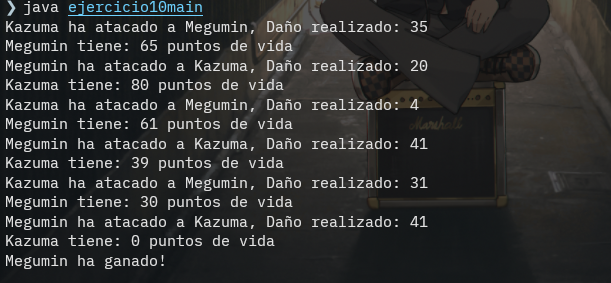
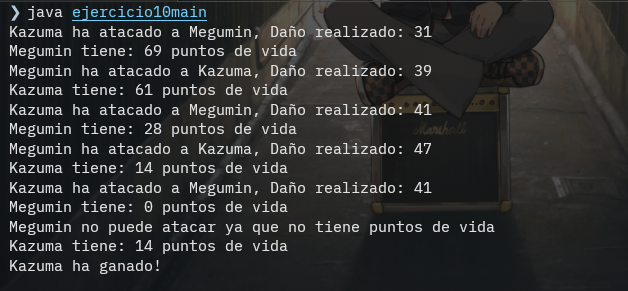

# **Ejercicio 10**

## Explicacion

En este ejercicio encontramos una clase personaje con un constructor que recibe dos parametros nombre y puntosAtaque, pero al inicializar el constructor tambien se inicializa el personaje con 100 puntos de vida. Tiene cuatro metodos, un getter para el nombre y otro getter para la vida. Tambien, tenemos un metodo atacar que recibe otro personaje y luego de calcular un valor random desde 0 hasta el maximo de puntosAtaque. Por ultimo, un metodo estaVivo que devuelve true cuando los puntos de vidas son mayores a 0 y false en caso contrario. 

## Imagen

### Primera iteracion

### Segunda iteracion

