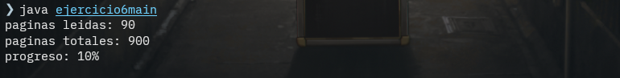

# ** Ejercicio 6 **

## Explicacion

En este ejercicio encontramos una clase libro con un constructor que admite tres parametros. En esta clase encontramos 3 metodos, Leer, el cual acepta un parametro paginas y lo suma a paginaActual y luego verifica si se termino la lectura y devuelve la cantidad de paginas leidas y en caso de haber terminado el libro, un mensaje que lo indica, getPaginasTotales, que devuelve la cantidad de paginas totales del libro, y por ultimo, mostrarProgreso que devuelve en forma de entero un progreso que representa como porcentaje la cantidad leida del libro.

## Imagen

