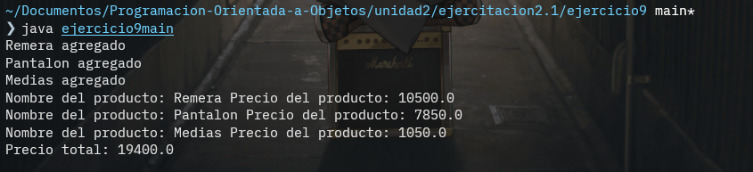

# **Ejercicio 9**

## Explicacion

En este ejercicio encontramos dos clases distintas, una clase producto y una clase carritoDeCompras. La clase producto tiene un constructor que se inicializa con dos parametros, un nombre y un precio. Esta clase solamente tiene un getter para el precio y un getter para el nombre que son utilizados en la clase carritoDeCompras, en la cual el constructor que no recibe parametros y este inicializa una arraylist vacia. Luego con los metodos de esta clase podemos agregarProductos, calcularTotal y mostrarDetalle.

## Imagen

